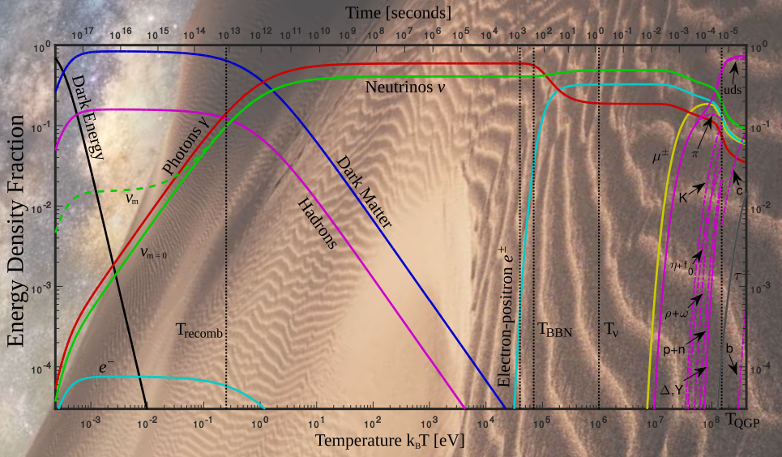

# thesis-collab-project
Quarks to Cosmos: Particles and plasma in cosmological evolution



## abstract
We describe in the context of the particle physics (PP) standard model (SM) ‘PP-SM’ the understanding of the primordial properties and composition of the Universe in the temperature range $130\,\textrm{GeV}>T>20\,\textrm{keV}$. The Universe evolution is described using FLRW cosmology. We present a global view on particle content across time and describe the different evolution eras using deceleration parameter *q*. In the considered temperature range the unknown cold dark matter and dark energy content of $\varLambda \textrm{CDM}$ have a negligible influence allowing a reliable understanding of physical properties of the Universe based on PP-SM energy–momentum alone. We follow the arrow of time in the expanding and cooling Universe: After the PP-SM heavies (*t*, *h*, *W*, *Z*) diminish in abundance below $T\simeq 50\,\textrm{GeV}$, the PP-SM plasma in the Universe is governed by the strongly interacting Quark-Gluon content. Once the temperature drops below $T\simeq 150\,\textrm{MeV}$, quarks and gluons hadronize into strongly interacting matter particles comprising a dense baryon-antibaryon content. Rapid disappearance of baryonic antimatter ensues, which adopting the present day photon-to-baryon ratio completes at $T_\textrm{B}=38.2\,\textrm{MeV}$. We study the ensuing disappearance of strangeness and mesons in general. We show that the different eras defined by particle populations are barely separated from each other with abundance of muons fading out just prior to $T=\mathcal{O}(2.5)\,\textrm{MeV}$, the era of emergence of the free-streaming neutrinos. We develop methods allowing the study of the ensuing speed of the Universe expansion as a function of fundamental coupling parameters in the primordial epoch. We discuss the two relevant fundamental constants controlling the decoupling of neutrinos. We subsequently follow the primordial Universe as it passes through the hot dense electron-positron plasma epoch. The high density of positron antimatter disappears near $T=20.3\,\textrm{keV}$, well after the Big-Bang Nucleosynthesis era: Nuclear reactions occur in the presence of a highly mobile and relatively strongly interacting electron-positron plasma phase. We apply plasma theory methods to describe the strong screening effects between heavy dust particle (nucleons). We analyze the paramagnetic characteristics of the electron-positron plasma when exposed to an external primordial magnetic field.

## authors
[Johann Rafelski](https://orcid.org/0000-0001-8217-1484), [Jeremiah Birrell](https://orcid.org/0000-0002-2289-4856), [Christopher Grayson](https://orcid.org/0000-0001-9985-1822), [Andrew Steinmetz](https://orcid.org/0000-0001-5474-2649), [Cheng Tao Yang](https://orcid.org/0000-0001-5038-8427)

## cite as
<!-- BEGIN GENERATED: cite -->
Rafelski, J., Birrell, J., Grayson, C., Steinmetz, A., Yang, C. T. Quarks to Cosmos: Particles and plasma in cosmological evolution. *Eur. Phys. J. Spec. Top.* 234, 1125–1329 (2025). https://doi.org/10.1140/epjs/s11734-025-01470-w

```bibtex
@article{Rafelski:2024fej,
    author = "Rafelski, Johann and Birrell, Jeremiah and Grayson, Christopher and Steinmetz, Andrew and Yang, Cheng Tao",
    title = "{Quarks to Cosmos: Particles and plasma in cosmological evolution}",
    eprint = "2409.19031",
    archivePrefix = "arXiv",
    primaryClass = "hep-ph",
    doi = "10.1140/epjs/s11734-025-01470-w",
    journal = "Eur. Phys. J. ST",
    volume = "234",
    number = "7",
    pages = "1125--1329",
    year = "2025"
}
```
<!-- END GENERATED: cite -->

## doi/arXiv id
<!-- BEGIN GENERATED: ids -->
- https://doi.org/10.1140/epjs/s11734-025-01470-w
- https://arxiv.org/abs/2409.19031
<!-- END GENERATED: ids -->

## contents
- `art/` — the graphical abstract shown above (`art_energyFractions.*`, with its master SVG) and `gfac.png`.
- `extra_fig_removal.sh` — renames files in `plots/` that the LaTeX log doesn't reference, to find unused figures.

## license
### published article
Copyright © 2025, The Author(s).

Open Access. This article is licensed under a [Creative Commons Attribution 4.0 International License][cc-by], which permits use, sharing, adaptation, distribution and reproduction in any medium or format, as long as you give appropriate credit to the original author(s) and the source, provide a link to the Creative Commons licence, and indicate if changes were made. The images or other third party material in this article are included in the article's Creative Commons licence, unless indicated otherwise in a credit line to the material. If material is not included in the article's Creative Commons licence and your intended use is not permitted by statutory regulation or exceeds the permitted use, you will need to obtain permission directly from the copyright holder.

### this repository
The contents of this repository are licensed under [CC BY 4.0][cc-by], the same license as the published article (see `LICENSE`). `extra_fig_removal.sh`: MIT (see the header of the script).

[![CC BY 4.0][cc-by-image]][cc-by]

[cc-by]: https://creativecommons.org/licenses/by/4.0/
[cc-by-image]: https://i.creativecommons.org/l/by/4.0/88x31.png
